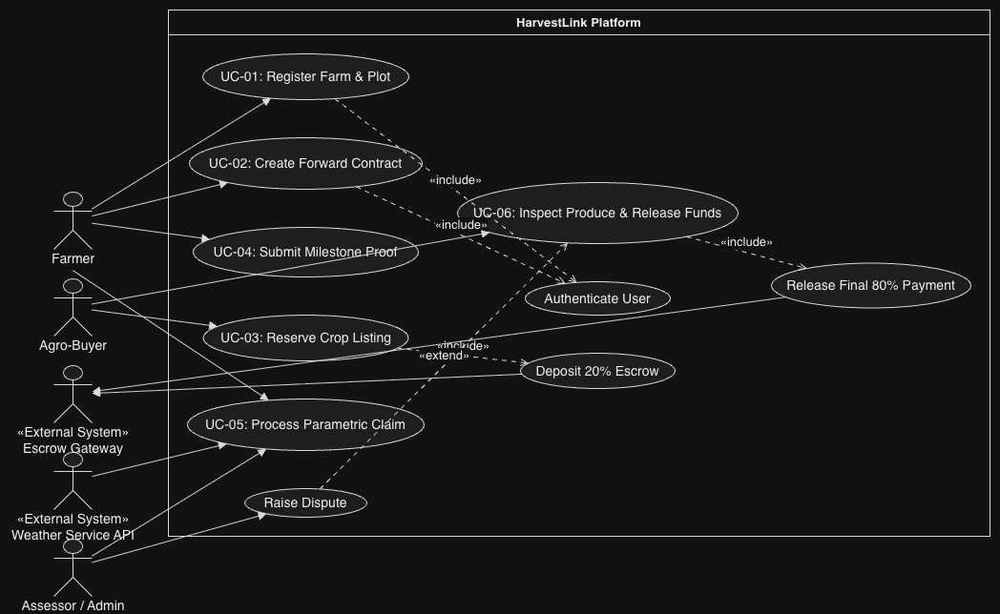
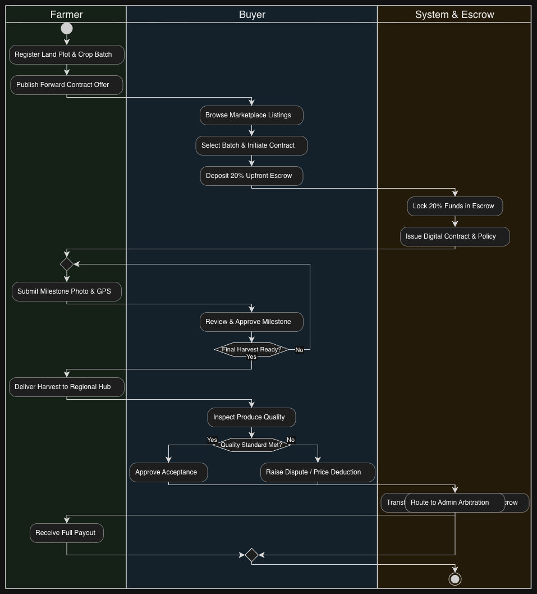
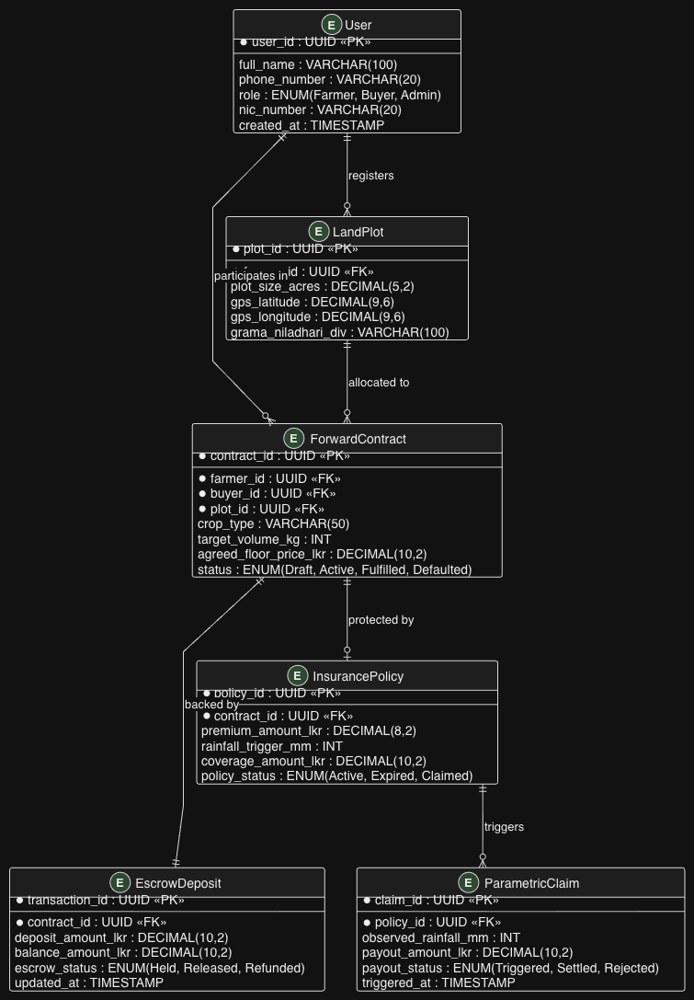

# HarvestLink — Pre-Harvest Forward Contracts & Parametric Micro-Insurance Platform

> An industry-standard Agile Business Analysis and Product Ownership portfolio artifact designed to bridge price volatility and climate risks for smallholder vegetable farmers in Sri Lanka.

---

##  Executive Summary
Smallholder farmers face steep intermediary price deductions at wholesale distribution hubs and recurrent climate damage. Commercial grocery chains simultaneously struggle with supply predictability and quality inspection. **HarvestLink** introduces a forward contract marketplace combined with a milestone-based crop tracking module and automated parametric rainfall insurance.

---

##  Repository Artifacts
- **[Project Charter (PDF)](docs/HarvestLink_Project_Charter_v1.0.pdf)** — Baseline scope boundaries, stakeholder mapping, and project governance.
- **[Agile Specifications & User Stories (PDF)](docs/HarvestLink_Agile_Requirements_v1.0.pdf)** — 6 Core User Stories with Gherkin Acceptance Criteria, NFRs, and RTM.

---

## User Personas
1. **Sunil Perera (Smallholder Producer):** Focuses on guaranteed pre-harvest pricing and automated insurance payouts.
2. **Chamara Silva (Commercial Buyer):** Focuses on procurement transparency, milestone photo validation, and escrow-backed agreements.
3. **Saman Wickramasinghe (Assessor / System Admin):** Focuses on parametric trigger validation, fraud mitigation, and dispute arbitration.

---

##  Core Features (User Story Matrix)
| Story ID | Domain Area | Role | Summary Scope |
| :--- | :--- | :--- | :--- |
| **US-01** | Farm Profiling | Farmer | Plot sizing, GPS coordinates, and crop cycle registration. |
| **US-02** | Forward Agreement | Farmer | Pre-harvest floor price publication. |
| **US-03** | Escrow Commitment | Buyer | 20% upfront deposit locking for batch reservations. |
| **US-04** | Growth Validation | Farmer | Milestone photo verification at Planting, Flowering, and Pre-Harvest. |
| **US-05** | Parametric Insurance | Farmer | Weather anomaly claims triggered by precipitation telemetry. |
| **US-06** | Quality & Settlement | Buyer/Admin | Hub quality grading and final escrow balance clearance. |

---

##  Author & Academic Background
- **Author:** Dilshani Rathnayake
- **Role:** Lead Business Analyst & Agile Project Coordinator
- **Affiliation:** Department of Computing and Information Systems, Sabaragamuwa University of Sri Lanka

- ---

##  Process & Architecture Models (Day 3)

### 1. UML Use Case Architecture

### 2. End-to-End Business Process (BPMN / Activity Workflow)

### 3. Data Architecture & Relational ERD

