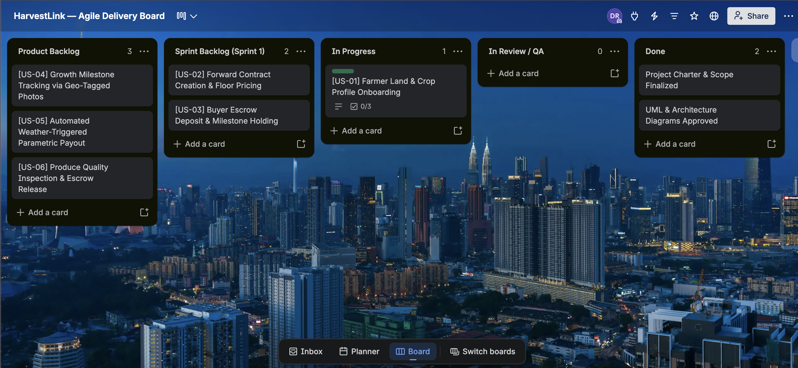

# HarvestLink — Pre-Harvest Forward Contracts & Parametric Micro-Insurance Platform

> An industry-standard Agile Business Analysis and Product Ownership portfolio artifact designed to bridge price volatility and climate risks for smallholder vegetable farmers in Sri Lanka.

---

##  Executive Summary
Smallholder farmers face steep intermediary price deductions at wholesale distribution hubs and recurrent climate damage. Commercial grocery chains simultaneously struggle with supply predictability and quality inspection. **HarvestLink** introduces a forward contract marketplace combined with a milestone-based crop tracking module and automated parametric rainfall insurance.

---

##  Repository Artifacts
- **[Project Charter (PDF)](docs/HarvestLink_Project_Charter_v1.0.pdf)** — Baseline scope boundaries, stakeholder mapping, and project governance.
- **[Agile Specifications & User Stories (PDF)](docs/HarvestLink_Agile_Requirements_v1.0.pdf)** — 6 Core User Stories with Gherkin Acceptance Criteria, NFRs, and RTM.

---

## User Personas
1. **Sunil Perera (Smallholder Producer):** Focuses on guaranteed pre-harvest pricing and automated insurance payouts.
2. **Chamara Silva (Commercial Buyer):** Focuses on procurement transparency, milestone photo validation, and escrow-backed agreements.
3. **Saman Wickramasinghe (Assessor / System Admin):** Focuses on parametric trigger validation, fraud mitigation, and dispute arbitration.

---

##  Core Features (User Story Matrix)
| Story ID | Domain Area | Role | Summary Scope |
| :--- | :--- | :--- | :--- |
| **US-01** | Farm Profiling | Farmer | Plot sizing, GPS coordinates, and crop cycle registration. |
| **US-02** | Forward Agreement | Farmer | Pre-harvest floor price publication. |
| **US-03** | Escrow Commitment | Buyer | 20% upfront deposit locking for batch reservations. |
| **US-04** | Growth Validation | Farmer | Milestone photo verification at Planting, Flowering, and Pre-Harvest. |
| **US-05** | Parametric Insurance | Farmer | Weather anomaly claims triggered by precipitation telemetry. |
| **US-06** | Quality & Settlement | Buyer/Admin | Hub quality grading and final escrow balance clearance. |

---

##  Author & Academic Background
- **Author:** Dilshani Rathnayake
- **Role:** Lead Business Analyst & Agile Project Coordinator
- **Affiliation:** Department of Computing and Information Systems, Sabaragamuwa University of Sri Lanka

- ---

##  Process & Architecture Models (Day 3)

### 1. UML Use Case Architecture

### 2. End-to-End Business Process (BPMN / Activity Workflow)

### 3. Data Architecture & Relational ERD

---

##  Agile Sprint Planning & Delivery Board (Day 4)

### Sprint 1 Overview & Delivery Board
The product backlog was prioritized using the **MoSCoW framework** and estimated with **Fibonacci Story Points**. Sprint 1 focuses on foundational onboarding, contract generation, and escrow locking.

* **Sprint Cadence:** 2 Weeks
* **Committed Velocity:** 21 Story Points
* **Sprint Goal:** Enable a smallholder farmer to register land/crops and execute a forward contract secured by a 20% buyer escrow deposit.

**Interactive Agile Board:** [View Live HarvestLink Trello Board](https://trello.com/invite/b/6add731bece4478de0449dae/ATTI3e568abd1ab1b28ee0d3b27f16b0e92834DA106E/harvestlink-agile-delivery-board)
---

## 🏃 Phase 4: Agile Sprint Planning & Backlog Management (Day 4)

### 1. Sprint Framework & Planning Parameters
HarvestLink adopts a standard **Scrum** framework with 2-week iterations to ensure rapid value delivery and feedback loops.

* **Sprint Duration:** 2 Weeks (10 Business Days)
* **Team Velocity:** **21 Story Points** (based on team capacity)
* **Sprint 1 Primary Goal:** Enable smallholder farmers to list crops and agro-buyers to lock contracts via a 20% upfront escrow deposit.

---

### 2. MoSCoW Prioritization & Story Point Estimation
Work items are prioritized using MoSCoW and sized using standard **Fibonacci Story Points (1, 2, 3, 5, 8, 13)** based on complexity, risk, and dependencies.

| ID | User Story Title | MoSCoW Priority | Story Points | Sprint Target |
| :--- | :--- | :--- | :--- | :--- |
| **US-01** | Farmer Land & Crop Profile Onboarding | **Must Have** | **5** | Sprint 1 |
| **US-02** | Forward Contract Creation & Floor Pricing | **Must Have** | **8** | Sprint 1 |
| **US-03** | Buyer Escrow Deposit & Milestone Holding | **Must Have** | **8** | Sprint 1 |
| **US-04** | Growth Milestone Tracking via Geo-Photos | Should Have | 5 | Sprint 2 |
| **US-05** | Weather-Triggered Parametric Payout | Should Have | 8 | Sprint 2 |
| **US-06** | Produce Inspection & Escrow Release | Should Have | 5 | Sprint 2 |
| **US-07** | Low-Connectivity SMS Notification Fallback | Could Have | 3 | Backlog |
| **US-08** | Multi-Currency Cross-Border Settlement | Won't Have | 13 | Future Scope |

> **Sprint 1 Committed Velocity:** $5 + 8 + 8 = \mathbf{21\text{ Points}}$

---

### 3. Agile Governance: DoR & DoD

#### Definition of Ready (DoR)
A User Story is committed to a Sprint only when:
1. Written using standard User Story format (`As a... I want to... So that...`).
2. Acceptance Criteria defined in testable Gherkin format (`Given-When-Then`).
3. Database entities and relations validated against the ERD.
4. Story points estimated and agreed upon by the engineering team.

#### Definition of Done (DoD)
A User Story is marked complete only when:
1. All functional Gherkin Acceptance Criteria pass QA validation.
2. Unit test coverage exceeds 80%.
3. Peer code review completed with zero open issues.
4. Successfully deployed to the staging environment.
5. Formal acceptance sign-off by the Business Analyst / Product Owner.

---

### 4. Interactive Agile Board
Sprint 1 progress and backlog items are visually tracked via the Agile Delivery Board:

 **Agile Kanban Board:** [View HarvestLink Delivery Board](https://trello.com/invite/b/6add731bece4478de0449dae/ATTI3e568abd1ab1b28ee0d3b27f16b0e92834DA106E/harvestlink-agile-delivery-board)
